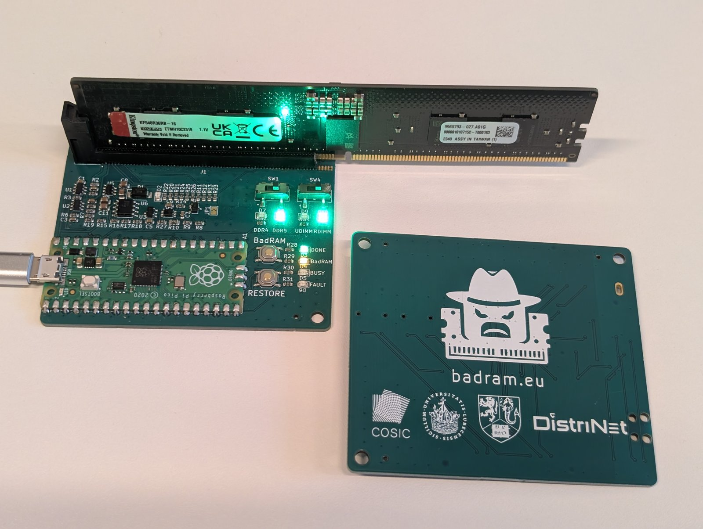

# SPD programmer board

A small board to read, edit, program and restore the SPD EEPROM of **DDR4 and
DDR5 DIMMs** (UDIMM and RDIMM), built around a Raspberry Pi Pico (RP2040) and
half of a cut DDR5 DIMM socket. Edits can be made from a PC (`spdtool`) or
with no PC at all: insert a module, hold **Program**, and the board applies a
preset (by default a BadRAM-style extra row address bit) while keeping a
backup; **Restore** undoes it.

- DDR4 (EE1004 + TSE2004) and DDR5 (SPD5118 hub) on one half socket.
- Reversible write protection: DDR4 with the SA0 high voltage generated on the
  board, DDR5 through the hub's offline mode.
- Safety: rails are only on during an operation, after the mode switches and a
  seating check; current-limited supplies; watchdog.
- Decoding and editing of speed, timings, refresh, capacity and identity
  fields; CRCs and the serial number are updated automatically.
- Presets for the Program button are written in Python and uploaded over USB.

| Path | Contents |
|---|---|
| [`kicad/`](kicad/) | KiCad 10 project: schematic, PCB, project footprints (`spd-programmer.pretty`), JLCPCB BOM and placement files, Gerbers |
| [`firmware/`](firmware/) | Pico SDK firmware: USB command interface, buttons, presets ([README](firmware/README.md)) |
| [`host/`](host/) | `spdtool`, the Python host tool and library ([README](host/README.md)) |
| [`docs/`](docs/) | Reference documentation: [hardware](docs/hardware.md), [Program/Restore design and formats](docs/program-restore.md), [firmware internals](docs/firmware.md) |

## Using it

1. Set the two mode switches (DDR4/DDR5, UDIMM/RDIMM) to match the module;
   two of the four mode LEDs show the selection. **Get DDR4/DDR5 right before
   doing anything:** the board checks the module type only after powering it,
   and a DDR4 module in DDR5 mode briefly gets 5 V or 3.3 V on its VPP pins.
2. Insert the module: **DDR5 normally, DDR4 rotated 180°**, pushed fully
   against the end of the socket.
3. From a PC: `pip install ./host`, then `spdtool info`. Without a PC: hold
   Program (the button labelled **BadRAM** on the board) for 1 s to apply the
   active preset (by default `badram-row`), or press **Restore** to undo it.

| LED | Meaning |
|---|---|
| Busy | The module is powered: **do not remove it** |
| Done | The last operation succeeded |
| Modified (labelled BadRAM) | The module carries a Program change (Restore undoes it) |
| Fault | The last button press failed (see below) |
| HV | The DDR4 write-protect voltage is on (only during a DDR4 write-protect change) |
| DDR4 / DDR5 / UDIMM / RDIMM | The mode switch positions |

After a failed button press, Fault stays lit and goes dark briefly **N times**
every few seconds, until the next press:

| N | Problem | What to check |
|---|---|---|
| 1 | Insertion | a mode switch between positions; module not inserted, not fully seated, or offset by a pin |
| 2 | Electrical | no answer from the module (I2C), supply too low, over-current: reseat it, check the contacts |
| 3 | Wrong module | the module type doesn't match the switches, or the active preset has nothing for this generation |
| 4 | Refused | already modified (Restore first), nothing to restore, the preset doesn't apply (e.g. already at the maximum), or the module changed since Program |
| 5 | Write failed | write protection couldn't be cleared, or the read-back didn't match |

`spdtool button` shows the exact reason for the last press.

See [`host/README.md`](host/README.md) for everything `spdtool` does, and how
to write your own presets.

## How it works

A summary; [`docs/hardware.md`](docs/hardware.md) has the details and the
reasoning behind each block.

**One socket for both generations.** The board uses contacts 1–69 and
145–213 of a DDR5 socket cut in half. A DDR4 module rotated by 180° puts its
SPD pins on the same few contacts, so one footprint serves both. Only these
contacts are connected:

| Contact | DDR4 (rotated) | DDR5 UDIMM | DDR5 RDIMM | Board |
|---|---|---|---|---|
| 1 | VPP | VIN_BULK | VIN_BULK | 5 V, switched, current-limited (DDR5 UDIMM only) |
| 3 | VPP | RFU | VIN_MGMT | 3.3 V, switched, current-limited (DDR5 RDIMM only) |
| 4 | SDA | HSCL | HSCL | I2C |
| 5 | VDDSPD | HSDA | HSDA | DDR4: 2.5 V supply (switched, 47 Ω); DDR5: I2C data |
| 6 | VSS | VSS | VSS | GND |
| 8 | VSS | VSS | VSS | seating check |
| 148 | SCL | HSA | HSA | DDR4: I2C clock; DDR5: grounded by a FET |
| 149, 51 | SA1, SA2 | RFU, CB0_A | RFU, CB0_A | 10 k to GND |
| 150 | SA0 | VSS | RFU | 10 k to GND; 8.5 V for DDR4 write-protect commands |
| 151 | VSS | PWR_EN | VSS | 10 k to GND (keeps the DDR5 UDIMM PMIC regulators off) |

**Power.** Everything comes from the Pico's USB. Each mode enables only its own
supplies, and only during an operation: a DDR5 UDIMM gets 5 V on VIN_BULK, a
DDR5 RDIMM 3.3 V on VIN_MGMT (both behind TPS2553 current-limit switches); the
PMIC's own LDO then powers the SPD hub, while its main regulators stay off. A
DDR4 module gets 2.5 V on VDDSPD. The I2C pull-ups go to a switched 2.5 V rail,
which suits the DDR4 RDIMM register's 2.5 V I2C as well as the other modules.

**Write protection.** DDR5: HSA is grounded before the hub is powered, which
starts it in offline mode, where the block protection can be cleared. DDR4:
the reversible write-protect commands need 7–10 V on SA0 (contact 150); a
charge-pump doubler and an 8.5 V LDO generate it, only for the duration of the
command and only in DDR4 mode.

**Seating check.** Contact 8 is VSS on every module type. Before any rail is
enabled the firmware measures it with a short pull-up pulse: VSS means
seated; a module offset by one pin puts a data or unused pad there instead,
and the board refuses to power it. The firmware also checks that the SPD type
bytes match the mode switches before it writes anything.

## Building one

- **PCB and assembly:** `kicad/` contains the Gerbers and the JLCPCB BOM and
  placement files; all parts except the Pico and the socket can be assembled by
  JLCPCB.
- **Pico:** a Raspberry Pi Pico (RP2040), soldered by its castellations.
- **Socket:** an Amphenol DDR504112805K (288-pin DDR5, vertical SMT), cut at
  the key; one socket gives two boards. The board uses positions 1–69 counted
  from the end tower; remove the key bump on the half that has it. Solder it
  by hand: hot air without bottom heating melts the housing.
- **Firmware:** build and flash as in [`firmware/README.md`](firmware/README.md).
- **Check:** with an empty socket, `spdtool status` and `spdtool debug` let you
  measure each mode's supplies before inserting a module (`host/README.md`,
  "Debugging and bring-up").

## Status

The first boards are built and tested with DDR5 RDIMMs (one with an XMP 3.0
profile) and a DDR4 RDIMM: reading, writing, write protection (DDR4 with the
high voltage), seating detection, the buttons and Program/Restore with every
built-in preset. DDR5 UDIMMs are not tested yet.

## Caution

Changing the SPD of a module changes how a system configures it; a wrong value
can keep a machine from booting. `spdtool` and the Program button keep backups
of what they change, but keep your own copy (`spdtool dump`) before editing a
module you care about.

## License

MIT (see [`LICENSE`](LICENSE)), for the hardware design files in `kicad/` as
well as the firmware and the host tool.

